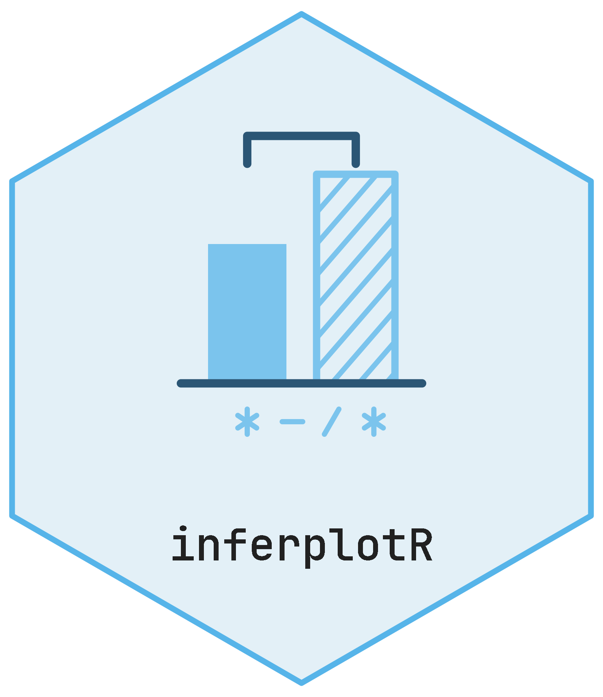

# infereportR <picture class="cttir-readme-logo"><source class="cttir-logo-dark-source" media="(prefers-color-scheme: dark)" srcset="man/figures/logo-dark.png" /></picture>

Tables, manuscript-ready values, ggplot annotations and black-and-white figures
from finalized statistical results. Numerical inference belongs to
**infercalcR**; guidance and prospective planning belong to **inferguidR**.
infereportR never computes a statistic itself: every estimate, interval, test
statistic, p-value and adjustment comes from infercalcR, and every displayed
number is formatted by the same shared formatters.

| Package | Role |
|---|---|
| infercalcR | computes results (estimates, intervals, p-values, provenance) |
| inferguidR | plans analyses (power, procedure choice) |
| **infereportR** | **formats results as tables and text, annotates ggplot2 plots and draws black-and-white figures whose inference layers compute through infercalcR** |

Since version 0.2.0 the figure layer, formerly the separate package
inferplotR, is part of infereportR, and ggplot2 is a required dependency.
Reporting does not require inferguidR, a table framework or testthat.

## Installation

R 4.1.0 or later is required. Neither package is on CRAN yet. infereportR
imports infercalcR, so infercalcR is submitted to CRAN first and infereportR
follows once infercalcR is available there. Once both are on CRAN:

```r
install.packages("infereportR")
```

Until then, install infercalcR first, then infereportR, from GitHub:

```r
install.packages("remotes")
remotes::install_github("CTTIR/infercalcR")
remotes::install_github("CTTIR/infereportR", build_vignettes = TRUE)
```

The documentation site, with the reference and seven vignettes, is at
<https://cttir.github.io/infereportR/>. Start with "Getting started with
infereportR"; "Comparison families, adjusted p-values and plot annotations"
and "Descriptive tables" cover the remaining reporting features. For figures,
"Figures: theme, scales, labels and export" covers the theme, scales, labels,
modes, export and the APA check; "Inference layers", "Character mode" and
"The figure gallery" cover the rest.

## Tables and text

```r
library(infercalcR)
library(infereportR)

# A finalized result can be rendered without observations or a model object.
r <- new_inference_result(
  data.frame(row_id = "A-B", variable_id = "outcome", component = "contrast",
    estimand = "mean difference", contrast = "A minus B", estimate = -1.2,
    conf.low = -2.1, conf.high = -0.3, conf.level = 0.95,
    interval.method = "Welch t", interval.scale = "difference",
    interval.scope = "pointwise", p.value = 0.012, status = "ok"),
  list(method_id = "welch_example", result_id = "study-1"))
report_table(r)
report_text(r)
report_text(r, template = "{contrast}: {estimate} {ci}; {p}")
```

The table retains analytical precision in its original columns. Display values
have separate `_display` columns; `p_selected` and `p_selection` identify the
chosen stored p-value. `report_metadata()` returns provenance, population and
complete-family adjustment metadata. `p = "adjusted"` errors when adjusted
values are absent. Filter by `rows` only after adjustment has been performed on
the full declared family in infercalcR.

A tiny p-value or stored zero displays a threshold, never `p = 0`. Missing and
unresolved results cannot become `ns`. Full text retains the supplied estimand,
contrast, interval policy, confidence level, sample size and status. It makes no
clinical or causal interpretation. The same formatters supply tables, text and
plot labels. Decimal-mark changes affect presentation only.

## Descriptive summaries

```r
d <- data.frame(outcome = c(1, 2, NA, 4), group = c("A", "A", "B", "B"))
report_descriptive(d, group = "group", units = c(outcome = "mm"))
```

The raw-data route delegates to `infercalcR::describe_data()` and performs no
hypothesis test. Ordered factors remain categorical. Output includes group and
variable denominators, missing counts, labels and units. To add already computed
inference, supply `inference`, an explicit `mapping` data.frame with
`variable_id`, `result_id`, `row_id`, and an `inference_population` label. At most
one inference row per variable is supported. Descriptive and inferential
populations remain separately labeled.

## ggplot annotations

```r
d <- data.frame(group = rep(c("A", "B"), each = 3), value = c(1, 3, 4, 2, 5, 6))
p <- ggplot2::ggplot(d, ggplot2::aes(group, value)) + ggplot2::geom_point()
positions <- data.frame(row_id = "A-B", xmin = 1, xmax = 2, y_position = 7)
p + stat_inference(r, positions, label = "estimate_ci_p")
```

`stat_inference()` draws results that are final before the plot exists, at
the positions you give. To compute the inference from the plotted data
instead, use the inference layers of the figure layer below.

Positions must match selected stable row IDs exactly. Named `group1`/`group2`
endpoints require `groups` in the plotted factor-level order; changing visual
order does not reverse the scientific contrast. Numeric endpoints support
explicit dodge positions. Omnibus annotations use `x`, `y_position` and
`type = "text"`. Nonsignificant rows are visible by default.

All coordinates and offsets are in original data units. A `y_position` of 100
maps to 2 under `scale_y_log10()` once. Cartesian plots and `coord_flip()` are
supported. For horizontal labels use `text_hjust = -0.1, text_vjust = 0.5`
and choose adequate scale expansion. `annotate_inference(plot, ...)` checks an existing coordinate system;
later-added coordinates cannot be guarded. Arbitrary nonlinear coordinates,
automatic placement and automatic dodge/free-scale inference are outside scope.

Facet-specific results require `facet_vars`, with identical nonmissing keys in
stored result rows and positions. Missing declared keys error instead of
broadcasting. A list of layers cannot infer undeclared subgroup meaning or
validate arbitrary facets added later; maintain this explicit mapping contract.

## Figures

The figure layer is a ggplot2 extension that you add with `+` like a theme.
Its figures are strictly black and white, follow the APA figure rules for
papers and the Bleisatz grid for slides, and can be redrawn on a character
grid in 1980s home-computer style. Its inference layers compute their
statistics through infercalcR, label them with the display strings of
`report_table()`, and the full results stay retrievable from the figure.

### One line on top of ggplot

```r
library(ggplot2)
library(infereportR)

p <- ggplot(PlantGrowth, aes(group, weight)) +
  report_figure(compare = "t_means_two_independent_welch", reference = "ctrl",
                adjust = "holm", omnibus = "anova_one_way") +
  labs(x = "Group", y = "Dried weight (g)")
p
```

`report_figure()` returns a plain list of ggplot2 components: the figure
theme, the black-and-white scales, the observations as open circles, the group
means with 95% confidence intervals and the tests you name. Here those are a
one-way analysis of means and Welch t-tests of each treatment against the
control, Holm-adjusted as one family. No test is added unless its procedure is named,
and with more than one comparison the adjustment must be declared (`"none"` is
allowed). The same layers are available one by one as `stat_means()`,
`stat_compare()`, `stat_omnibus()` and `stat_correlation()`. Each panel of a
faceted plot is its own analysis.

The results behind the labels can be read back from the figure:

```r
names(inference_results(p))
#> [1] "infereportR:means:t_mean_one_sample:panel1:ctrl"
#> [2] "infereportR:means:t_mean_one_sample:panel1:trt1"
#> [3] "infereportR:means:t_mean_one_sample:panel1:trt2"
#> [4] "infereportR:omnibus:anova_one_way:panel1"
#> [5] "infereportR:compare:t_means_two_independent_welch:panel1"

figure_table(p)[, c("figure_layer", "contrast", "estimate_display", "p_display")]
#>   figure_layer        contrast estimate_display p_display
#> 1            2            <NA>             5.03 p < 0.001
#> 2            2            <NA>             4.66 p < 0.001
#> 3            2            <NA>             5.53 p < 0.001
#> 4            3            <NA>      unavailable p = 0.016
#> 5            4 trt1 minus ctrl           -0.371 p = 0.250
#> 6            4 trt2 minus ctrl            0.494 p = 0.096
```

`inference_results()` returns the infercalcR result objects, so they can be
validated or passed to `report_text()`. `figure_table()` binds their
`report_table()` rows into one table, with the layer and panel each row came
from, and reports adjusted p-values where an adjustment was made. Results
computed elsewhere can still be drawn on the same figure with
`stat_inference()`.

### Paired designs and figure builders

- `stat_paired()` draws a paired design as a slopegraph, one line per unit
  (`id`), and labels the mean change from a paired t or signed-rank procedure.
- `figure_forest()` draws a forest plot from a named list of infercalcR results.
- `figure_correlation_matrix()` runs one named correlation per pair of variables
  and draws circles and values in black and white.
- `stat_stacklabel()` names the categories of stacked bars beside the last bar
  instead of a legend.
- `stat_ecdf_guides()` adds median guides and curve labels to `stat_ecdf()`.

```r
ggplot(transform(sleep, drug = factor(group, labels = c("Drug 1", "Drug 2"))),
       aes(drug, extra, id = ID)) +
  stat_paired(method = "t_means_paired", unit = "h") +
  coord_cartesian(clip = "off") +
  theme_figure() +
  theme(plot.margin = margin(2, 21, 2, 2, unit = "mm")) +
  labs(x = NULL, y = "Extra sleep (h)")
```

The builders keep their results like the layers, so `inference_results()` and
`figure_table()` work on them too.

### Black and white by design

```r
chicks <- aggregate(weight ~ Diet + Time, data = ChickWeight, FUN = mean)
chicks$Diet <- paste("Diet", chicks$Diet)

q <- ggplot(chicks, aes(Time, weight, linetype = Diet, label = Diet)) +
  geom_line(show.legend = FALSE) +
  geom_endlabel() +
  scale_linetype_figure() +
  coord_cartesian(clip = "off") +
  theme_figure("paper", legend = "none") +
  theme(plot.margin = margin(2, 16, 2, 2, unit = "mm")) +
  labs(x = "Days since birth", y = "Mean weight (g)")

save_figure(q, file.path(tempdir(), "chicks.pdf"), preset = "journal_column")
save_figure(q + theme_figure("slide", legend = "none") +
              theme(plot.margin = margin(1, 16, 1, 1, unit = "mm")),
            file.path(tempdir(), "chicks-slide.png"), preset = "slide_side")
```

- `theme_figure()` is a complete theme with two targets. `"paper"` follows the
  APA figure rules: all text between 8 and 14 pt, one font family, the legend
  inside the panel. `"slide"` matches the Bleisatz Beamer theme: 1-bit, 1 mm
  margins and IBM Plex when it is installed. There is no gray anywhere; grid
  lines, when requested, are dotted black lines. IBM Plex ships with TeX Live
  (`fonts/opentype/ibm/plex`); for R, copy the Sans, Sans Condensed and Mono
  OTF files to `~/.fonts` and run `fc-cache -f` (see `?figure_font`).
- `scale_linetype_figure()`, `scale_shape_figure()` and `scale_colour_ink()`
  tell groups apart by line type and point shape instead of color.
  `scale_fill_hatch()` and `hatch_pattern()` fill areas with solid, open,
  hatched, dotted and crosshatched grid patterns, without any extra package.
  The scales never recycle values; too many groups is an error.
- `geom_endlabel()` labels each line at its last point instead of a legend.
- `figure_size()` holds size presets: journal single and double columns (85 and
  174 mm wide) and the Bleisatz slots `slide_full`, `slide_side` and
  `slide_half` (134, 86 and 64 mm wide, 44 mm high). `save_figure()` writes PDF
  (with `cairo_pdf()`), PNG, SVG or TIFF at a preset or at an explicit size.

### Modes

Every function that draws takes `mode = "light"` (black on white) or `"dark"`
(white on black) and `transparent = TRUE` for no background at all. Only the
two values change; pass the mode to the theme and to every layer.

- `save_figure_set()` writes one figure in light, dark and both transparent
  modes into `<dir>/<mode>/` (`dir` has no default; a deck uses
  `dir = "figures"`), with the same file name in every folder, so
  `\graphicspath{{figures/dark/}}` switches a whole `\usetheme[dark]{Bleisatz}`
  deck.
- `figure_gallery()` writes the twelve Bleisatz example figures this way:
  `Rscript -e 'infereportR::figure_gallery("figures")'`.

```r
build <- function(mode, transparent) {
  ggplot(chicks, aes(Time, weight, linetype = Diet, label = Diet)) +
    geom_line(colour = if (mode == "dark") "white" else "black", show.legend = FALSE) +
    geom_endlabel(mode = mode, transparent = transparent) +
    scale_linetype_figure() +
    coord_cartesian(clip = "off") +
    theme_figure("slide", legend = "none", mode = mode, transparent = transparent) +
    theme(plot.margin = margin(1, 16, 1, 1, unit = "mm")) +
    labs(x = "Days since birth", y = "Mean weight (g)")
}
save_figure_set(build, "chicks", preset = "slide_side",
                dir = file.path(tempdir(), "figures"), png = FALSE)
```

### Tufte options

Every aspect of Tufte's design is an option, and the default stays the
two-valued Bleisatz figure. `palette = "grey"` adds one grey for context and
`palette = "tufte"` adds red and green; the figure types are layers and
builders of their own: `geom_rangeframe()` with
`theme_figure(axes = "range")`, `geom_dotdash()`, `stat_quartiles()`,
`theme_figure(grid = "paper")` and `geom_papergrid()`, `figure_slopegraph()`,
`figure_sparklines()` with `sparkline_tex()` for LaTeX, and `stat_context()`.
`figure_size("margin")` is the 52 x 40 mm margin slot of a Tufte handout and
`figure_font("etbb")` finds ET Book. `figure_gallery(set = "tufte")` writes the
Tufte set of the Bleisatz gallery in six folders; see `vignette("tufte")`.

```r
ggplot(ChickWeight, aes(Time, weight, group = Chick, series = Diet, linetype = Diet)) +
  stat_context(highlight = "3", palette = "tufte") +
  geom_rangeframe() +
  labs(x = "Days since birth", y = "Weight (g)") +
  theme_figure("slide", legend = "none", axes = "range", palette = "tufte")
```

### APA check

`check_figure()` audits a plot against the APA Style figure rules and the
package's black-and-white rule and returns one row per check:

```r
check_figure(ggplot(mtcars, aes(wt, mpg)) + geom_point(colour = "red"))[, 1:3]
#>            check      source status
#> 1      text_size       APA 7   pass
#> 2    font_family       APA 7   pass
#> 3     two_values infereportR   fail
#> 4    axis_labels       APA 7   note
#> 5 embedded_title       APA 7   pass
#> 6    legend_case       APA 7   pass
```

The `detail` column names the offenders: here the red points, the gray panel
and the axis labels `wt` and `mpg`, which give no unit. The checks cover text
size (8 to 14 pt), sans serif fonts, black and white only, labeled axes with
units, no title inside the image and title-case legends. The figure number,
title and note belong to the manuscript and are outside the audit.

### Character mode

`char_grid()` redraws a single-panel ggplot on a monospaced character grid:

```r
d <- aggregate(weight ~ Time, data = ChickWeight, FUN = mean)
g <- ggplot(d, aes(Time, weight)) +
  geom_line() +
  geom_point() +
  labs(x = "Days since birth", y = "Mean weight (g)")
char_grid(g, width = 48, height = 14)
```

```
Mean weight (g)
    |                                       *
200 +                                    /*/
    |                                 /*/
    |                             /*//
150 +                          /*/
    |                      /*//
100 +               /*---*/
    |            /*/
 50 +    /*---*//
    |  */
    +--+--------+--------+-------+--------+----
       0        5        10      15       20
                  Days since birth
```

`charset = "unicode"` draws box-drawing lines and block fills, and
`case = "upper"` writes all text in capitals. End labels of `geom_endlabel()`
are written right of the plot, and the ASCII grid transliterates characters
such as `≥` to `>=`. `char_figure()` turns the grid back into a ggplot of
glyphs, either 1-bit black on white or, with `style = "c64"`, as the screen of
a Commodore 64 after power-on: light blue characters on a blue screen inside a
light blue border, ending with `READY.` and a cursor. `style = "c64bw"` keeps
that screen in two values, with a dot-halftone border. With `slot`, the figure
fills a slide slot; otherwise `char_size()` gives the file size at which the
glyphs line up, for `save_figure()`.

## Verification

`tools/gate.R` is the quality gate for every change. Its `quick` mode checks
that the documentation is in sync with the roxygen comments, scans `R/` for
banned patterns (color literals outside the design tokens, non-ASCII
characters, `sapply()`, `T`/`F`, `library()` calls), scans tracked files and
commit messages for attribution lines, runs the plain test scripts and runs
the testthat suite without failures, errors or warnings. The `full` mode adds
`R CMD check --as-cran` with zero errors, warnings and notes, vignettes
included. The `release` mode adds line coverage of at least 90% and the CRAN
incoming checks. GitHub Actions runs R CMD check on Linux (R release, devel and
oldrel-1), Windows and macOS, and a minimal lane on R 4.1 with the hard
dependencies only.

The reporting functions are tested by ordinary `tests/*.R` scripts against the
installed package. They cover precision, interval/p-value semantics,
no-computation guards, explicit populations/joins, and actual ggplot builds and
drawing. `INFER_SUITE_FULL=true` runs the provider views that need further
infercalcR dependencies; other runs label them as SKIP. Skips do not establish
backend support. Set `INFER_SUITE_PLOT_DIR` to retain plot artifacts during
verification.

The figure layer is tested with testthat (edition 3) under `tests/testthat/`.
These tests show that:

- every number drawn by an inference layer equals a direct infercalcR call on
  the same data (means, comparison families with their adjustment, omnibus
  tests, correlations and the fitted line), and every label is a
  `report_table()` display string, never `ns`;
- procedures and adjustments must be explicit, and errors have classes and keep
  the infercalcR condition as parent;
- facets give one analysis per panel, and `inference_results()` and
  `figure_table()` return what the layers computed;
- the theme resolves all text to 8 to 14 pt and uses only black and white; the
  scales follow the specified sequences and refuse to recycle; hatched plots
  render to PDF and PNG; the size presets have the specified sizes;
- `check_figure()` passes conforming figures and names the offenders in
  non-conforming ones;
- character grids are deterministic (snapshot tests of fixed plots), and
  `char_figure()` and `char_size()` agree on the grid size in every style;
- every figure is drawn in two values in each mode, and `figure_gallery()`
  reproduces every number of the Bleisatz example figures at the exact slot
  sizes.

## Acknowledgments and sources

infereportR is part of an inference suite with infercalcR and inferguidR. The
suite builds on the work of others. We gratefully acknowledge that work here and
cite it, so that every method can be traced to its source.

### DescrTab2, Institute of Medical Biometry, Heidelberg University

The suite is deeply inspired by **DescrTab2** [1], the R package for
publication-quality descriptive statistics tables developed at the Institute of
Medical Biometry (IMBI), Heidelberg University, by Jan Meis, Lukas Baumann,
Maximilian Pilz and Lukas Sauer, with contributions from Lorenz Uhlmann and
Csilla van Lunteren. Its documented test-choice tree, its validation statement
and its practice of computing each test with an established implementation (R's
stats package, exact2x2, DescTools and nlme) are the model for how the suite
chooses, computes and reports statistical tests. DescrTab2 was archived on CRAN
on 18 October 2025; its source code remains available on GitHub. We thank its
authors and IMBI Heidelberg for making their work openly available.

### Methodenberatung, University of Zurich

The methods-consulting pages of the University of Zurich [2] inspired the
guidance in this suite: their decision tree and step-by-step decision assistant
for choosing a statistical method, and their worked examples and explanations of
each method.

### G\*Power

The power and sample-size procedures of inferguidR follow the test inventory of
G\*Power 3.1 [3, 4], and the distribution calculator of infercalcR follows the
G\*Power 3.1.9.7 calculator. Their results are compared with values recorded
from G\*Power 3.1.9.7. G\*Power is neither distributed with nor called by these
packages.

### Figure rules and tokens

The text-size, font, legend, axis and title rules of the theme and of
`check_figure()` follow the APA Style page on figures [8]. The slide target
shares its 1-bit tokens (rules, hairlines, text width) with the Bleisatz Beamer
theme [12]; the slots, modes and twelve gallery figures follow the Bleisatz
example figures [14]. Text uses IBM Plex [10] when it is installed; no font is
bundled. The two colors of the C64 style are the VIC-II "blue" and "light blue"
of the Pepto palette by Philip Timmermann [9].

### Related work

Several packages showed what figures for statistical reports can look like and
inspired the figure layer [11]: the `theme_apa()` themes of jtools and papaja,
the pattern fills of fillpattern and ggpattern, the comparison brackets of
ggsignif and of `stat_compare_means()` in ggpubr, the statistics in figures of
ggstatsplot, and the terminal rendering of ggplots by `ggplotcli()` in plotcli.
They are credited as inspiration only. infereportR does not import them, and
every function was written from scratch: no code, tests, documentation or
examples of theirs were copied (clean-room). The figure layer differs from them
in that it runs only explicitly named procedures, takes every number from
infercalcR and every display string from `report_table()`, keeps the results
retrievable from the figure, shares its 1-bit tokens with a Beamer theme, audits
figures against the APA rules and renders character mode as a figure.

### Software

infereportR is written in R [5], imports infercalcR [6] and extends ggplot2
[7]; its ggproto objects were designed from the public ggplot2 extension guide
[13]. Hatch fills use the grid patterns of R 4.1.0 and later. Use
`citation("infereportR")` for this package and `citation()` or
`citation("<package>")` for R and the packages you used.

### References

1. Meis J, Baumann L, Pilz M, Sauer L (2022). *DescrTab2: Publication Quality Descriptive Statistics Tables*. R package version 2.1.16. <https://doi.org/10.32614/CRAN.package.DescrTab2>. Source code, including the development version 2.1.26: <https://github.com/imbi-heidelberg/DescrTab2>.
2. Universität Zürich, Methodenberatung. *Datenanalyse mit SPSS*: decision tree (Entscheidbaum), decision assistant (Entscheidassistent) and method pages with examples and explanations. <https://www.methodenberatung.uzh.ch/de/datenanalyse_spss.html>. Accessed 3 October 2026.
3. Faul F, Erdfelder E, Lang A-G, Buchner A (2007). G\*Power 3: A flexible statistical power analysis program for the social, behavioral, and biomedical sciences. *Behavior Research Methods*, 39(2), 175-191. <https://doi.org/10.3758/BF03193146>.
4. Faul F, Erdfelder E, Buchner A, Lang A-G (2009). Statistical power analyses using G\*Power 3.1: Tests for correlation and regression analyses. *Behavior Research Methods*, 41(4), 1149-1160. <https://doi.org/10.3758/BRM.41.4.1149>.
5. R Core Team. *R: A Language and Environment for Statistical Computing*. R Foundation for Statistical Computing, Vienna, Austria. <https://www.R-project.org/>.
6. Heller R. *infercalcR: Statistical Inference and Diagnostic Calculations*. R package. <https://github.com/CTTIR/infercalcR>.
7. Wickham H (2016). *ggplot2: Elegant Graphics for Data Analysis*. Springer, New York. <https://doi.org/10.1007/978-3-319-24277-4>.
8. American Psychological Association. *Figures*. APA Style, 7th ed. <https://apastyle.apa.org/style-grammar-guidelines/tables-figures/figures>.
9. Timmermann P ("Pepto"). VIC-II color analysis (Pepto palette), as shipped with the VICE emulator in `pepto-pal.vpl`: blue `35 28 79`, light blue `6C 5E B5`. <https://sources.debian.org/src/vice/3.9%2Bdfsg-1/data/C64/pepto-pal.vpl>.
10. IBM. *IBM Plex* typeface. SIL Open Font License. <https://github.com/IBM/plex>.
11. Related work, credited as inspiration only: jtools and papaja (`theme_apa()`), fillpattern and ggpattern (pattern fills), ggsignif and ggpubr (`stat_compare_means()`, comparison brackets), ggstatsplot (statistics in figures), plotcli (`ggplotcli()`, terminal rendering of ggplots).
12. CTTIR. *Bleisatz* Beamer theme, the slide counterpart whose tokens this package shares.
13. ggplot2 authors. *Extending ggplot2*. Vignette of the ggplot2 package: `vignette("extending-ggplot2", package = "ggplot2")`.
14. CTTIR (2026). *Bleisatz example figures*. Twelve example figures of the Bleisatz Beamer theme in light, dark and transparent modes, the visual reference of this package.
