<!-- cttir-vignette-logo: start -->
<style>
.cttir-vignette-logo { float: right; width: 120px; max-width: 30%; margin: 0 0 1rem 1.5rem; }
.cttir-vignette-logo img { width: 100%; height: auto; border: 0; background: transparent; box-shadow: none; }
.cttir-vignette-logo .cttir-vignette-logo-light { display: block; }
.cttir-vignette-logo .cttir-vignette-logo-dark { display: none; }
@media (prefers-color-scheme: dark) {
  .cttir-vignette-logo .cttir-vignette-logo-light { display: none; }
  .cttir-vignette-logo .cttir-vignette-logo-dark { display: block; }
}
[data-bs-theme="light"] .cttir-vignette-logo .cttir-vignette-logo-light { display: block; }
[data-bs-theme="light"] .cttir-vignette-logo .cttir-vignette-logo-dark { display: none; }
[data-bs-theme="dark"] .cttir-vignette-logo .cttir-vignette-logo-light { display: none; }
[data-bs-theme="dark"] .cttir-vignette-logo .cttir-vignette-logo-dark { display: block; }
</style>
<div class="cttir-vignette-logo">
  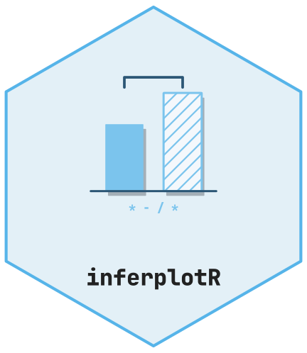
  
</div>
<!-- cttir-vignette-logo: end -->

```{r setup, include = FALSE}
knitr::opts_chunk$set(collapse = TRUE, comment = "#>",
  dev = if (requireNamespace("ragg", quietly = TRUE)) "ragg_png" else "png")
```

The Bleisatz Beamer theme comes with twelve example figures. Each one teaches
one rule of the black-and-white system, and each is sized for one slot of a
Bleisatz frame. `figure_gallery()` rebuilds all twelve with the API of
inferplotR alone, in up to four modes: light, dark and both of them on a
transparent background. This vignette lists the figures, explains slots and
modes, and shows how a deck switches between the sets.

```{r packages}
library(ggplot2)
library(inferplotR)
```

## The twelve figures

| # | File name | Slot | What it shows | Built with |
|---|---|---|---|---|
| 01 | `01-timecourse-direct-labels` | side | lines labeled at their ends, no legend | `theme_figure()`, `scale_linetype_figure()`, `scale_shape_figure()`, `geom_endlabel()` |
| 02 | `02-raw-data-mean-ci` | side | every observation, mean and 95% CI beside it, Holm-adjusted Welch comparisons | `inferplot()` |
| 03 | `03-stacked-hatch` | side | open, hatched and solid fills, categories named beside the last bar | `geom_col()`, `scale_fill_hatch()`, `stat_stacklabel()` |
| 04 | `04-scatter-correlation` | half | Pearson correlation on a log axis, two-line label with n | `stat_correlation(label = "estimate_ci_p_n")` |
| 05 | `05-ecdf-distribution` | side | empirical distribution functions with median guides | `stat_ecdf()`, `stat_ecdf_guides()` |
| 06 | `06-forest-subgroups` | full | subgroup differences with 95% CIs, marker area proportional to n | `figure_forest()` |
| 07 | `07-small-multiples` | full | identical x axes, free y axes, end labels in the last panel | facets, `geom_endlabel()` |
| 08 | `08-correlation-matrix` | side | Spearman correlations as circles and values | `figure_correlation_matrix()` |
| 09 | `09-paired-slopegraph` | half | one line per patient, mean change with its 95% CI | `stat_paired()` |
| 10 | `10-character-mode` | side | figure 01 redrawn with text characters | `char_figure(style = "bw")` |
| 11 | `11-character-mode-c64` | half | the same in Commodore 64 colors, with `READY.` | `char_figure(style = "c64")` |
| 12 | `12-character-mode-c64-bw` | half | the C64 screen in two values, with a halftone border | `char_figure(style = "c64bw")` |

Each figure below is built and drawn by the package when this vignette is
rendered, in light mode at the size of its slot. The internal builders that
`figure_gallery()` calls are used directly, with the gallery's simulated data.

```{r gallery-data}
gallery_data <- inferplotR:::.ip_gallery_data()
gallery_figure <- function(i, mode = "light") {
  inferplotR:::.ip_gallery_builders[[i]](gallery_data, mode = mode, transparent = FALSE)
}
```

### 01. Time course with direct labels

```{r gallery-01, echo = FALSE, fig.width = 86 / 25.4, fig.height = 44 / 25.4, dpi = 150, out.width = "64%", fig.cap = "Lines are labeled at their ends; there is no legend to decode. Line type and marker shape separate the groups, never color.", fig.alt = "Time course with direct labels, light mode."}
gallery_figure(1)
```

### 02. Raw data, mean and 95% CI

```{r gallery-02, echo = FALSE, fig.width = 86 / 25.4, fig.height = 44 / 25.4, dpi = 150, out.width = "64%", fig.cap = "Every observation is shown (open circles), with the mean and 95% CI beside it. Comparisons with ISS < 16: Welch t-tests, Holm-adjusted p.", fig.alt = "Raw data, mean and 95% CI, light mode."}
gallery_figure(2)
```

### 03. Stacked bars with hatch fills

```{r gallery-03, echo = FALSE, fig.width = 86 / 25.4, fig.height = 44 / 25.4, dpi = 150, out.width = "64%", fig.cap = "Open, hatched and solid fills replace color. Categories are named beside the last bar instead of in a legend.", fig.alt = "Stacked bars with hatch fills, light mode."}
gallery_figure(3)
```

### 04. Scatter plot with correlation

```{r gallery-04, echo = FALSE, fig.width = 64 / 25.4, fig.height = 44 / 25.4, dpi = 150, out.width = "48%", fig.cap = "Pearson correlation of log IL-6 with ISS, with its 95% CI from infercalcR. The log axis is labeled in original units.", fig.alt = "Scatter plot with correlation, light mode."}
gallery_figure(4)
```

### 05. Empirical distribution functions

```{r gallery-05, echo = FALSE, fig.width = 86 / 25.4, fig.height = 44 / 25.4, dpi = 150, out.width = "64%", fig.cap = "The empirical distribution function shows every patient, the medians (dotted) and the spread in one figure.", fig.alt = "Empirical distribution functions, light mode."}
gallery_figure(5)
```

### 06. Forest plot of subgroups

```{r gallery-06, echo = FALSE, fig.width = 134 / 25.4, fig.height = 44 / 25.4, dpi = 150, out.width = "100%", fig.cap = "Subgroup estimates as differences with 95% CIs (Welch, infercalcR). Marker area is proportional to n; the dotted line is no difference.", fig.alt = "Forest plot of subgroups, light mode."}
gallery_figure(6)
```

### 07. Small multiples

```{r gallery-07, echo = FALSE, fig.width = 134 / 25.4, fig.height = 44 / 25.4, dpi = 150, out.width = "100%", fig.cap = "Three markers, one design: identical x axes, free y axes in their own units, lines labeled once in the last panel.", fig.alt = "Small multiples, light mode."}
gallery_figure(7)
```

### 08. Correlation matrix

```{r gallery-08, echo = FALSE, fig.width = 86 / 25.4, fig.height = 44 / 25.4, dpi = 150, out.width = "64%", fig.cap = "Spearman correlations: above the diagonal, circle area shows the strength, filled is positive and open is negative. The values are mirrored below the diagonal.", fig.alt = "Correlation matrix, light mode."}
gallery_figure(8)
```

### 09. Paired slopegraph

```{r gallery-09, echo = FALSE, fig.width = 64 / 25.4, fig.height = 44 / 25.4, dpi = 150, out.width = "48%", fig.cap = "Each line is one patient; the thick line is the mean. Paired t-test from infercalcR: mean change with its 95% CI.", fig.alt = "Paired slopegraph, light mode."}
gallery_figure(9)
```

### 10. Character mode

```{r gallery-10, echo = FALSE, fig.width = 86 / 25.4, fig.height = 44 / 25.4, dpi = 150, out.width = "64%", fig.cap = "The time course from figure 1 redrawn with text characters, as on an 80s home computer.", fig.alt = "Character mode, light mode."}
gallery_figure(10)
```

### 11. Character mode, C64 colors

```{r gallery-11, echo = FALSE, fig.width = 64 / 25.4, fig.height = 44 / 25.4, dpi = 150, out.width = "48%", fig.cap = "The same plot in C64 colors (Pepto palette) with the READY prompt. For effect only; not for data slides.", fig.alt = "Character mode, C64 colors, light mode."}
gallery_figure(11)
```

### 12. Character mode, C64 in two values

```{r gallery-12, echo = FALSE, fig.width = 64 / 25.4, fig.height = 44 / 25.4, dpi = 150, out.width = "48%", fig.cap = "The C64 screen in two values: black screen, white glyphs, a dot-halftone border for the lighter border blue.", fig.alt = "Character mode, C64 in two values, light mode."}
gallery_figure(12)
```

The data are simulated with fixed seeds, so the figures and every number on
them are the same on every run, and the random state of the R session is left
as it was. As everywhere in the package, the statistics come from infercalcR
and the displayed numbers from infereportR. One line in a shell writes all
twelve figures in all four modes into a deck's `figures/` folder:

```sh
Rscript -e 'inferplotR::figure_gallery("figures")'
```

`figure_gallery()` returns a table of the files it wrote. It writes PDF files
by default; `png = TRUE` adds a 300 dpi PNG beside each PDF. Since the full set
takes a while to render, this vignette does not run it; the figures above are
drawn by the same builders, and the dark versions are shown below.

## Dark mode

The same twelve figures in dark mode, white on black, for dark Bleisatz decks
and inverse frames. These images were rendered once with
`figure_gallery(png = TRUE)` at 150 dpi and are shipped with the vignette, so
that it does not draw every figure twice.

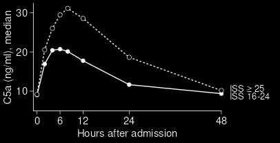

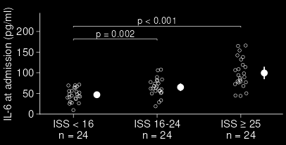

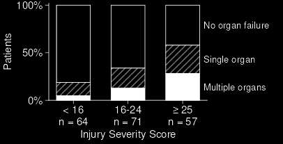

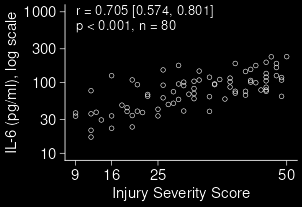

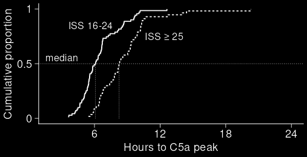

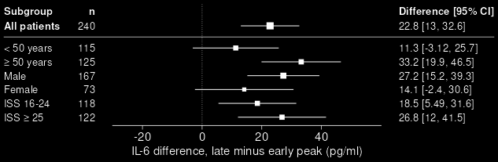

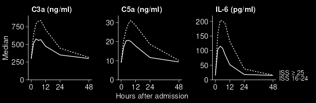

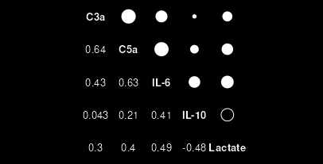

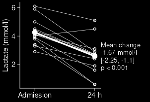

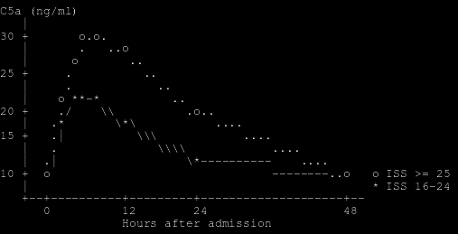

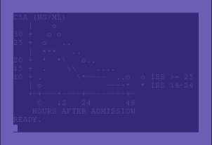

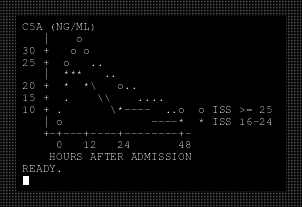

## Slots

A Bleisatz frame has room for a figure of 44 mm height below a two-line title,
with one source line left at the bottom. Three widths fill the frame body: the
full text width, the side figure next to a text column, and one of two
columns. `figure_size()` holds them as presets:

```{r slots}
slots <- c("slide_full", "slide_side", "slide_half")
do.call(rbind, lapply(slots, function(x)
  data.frame(slot = x, width = figure_size(x)$width, height = figure_size(x)$height)))
```

A figure saved at a slot's size is placed at 100% and never scaled, so its 9 pt
text stays 9 pt on the slide and lines up with the text of the frame. The
builders that need the slot width to lay out text take it as an argument:
`figure_forest(slot = )` and `char_figure(slot = )`, which then picks the
number of character rows that fill the slot height.

## Modes

Every function that draws takes `mode = "light"` or `"dark"` and
`transparent = FALSE` or `TRUE`, and passes them on. The modes change only the
two values of the figure:

| Mode | Background | Open fills and markers | Ink (lines, glyphs, text) |
|---|---|---|---|
| light | white | white | black |
| dark | black | black | white |
| light, transparent | none | none | black |
| dark, transparent | none | none | white |

The transparent modes contain the information only: no plot, panel or legend
background and no background behind hatch tiles. Character figures in the
transparent modes are glyphs only, without screen and border.

Here a paired design, the sleep data of Student (1908), drawn as figure 09 is:
one line per person, the means joined by a thick line, and the mean change with
its confidence interval from the paired t procedure of infercalcR.

```{r paired-build}
sleep_long <- transform(sleep, drug = factor(group, labels = c("Drug 1", "Drug 2")))

paired <- function(mode = "light", transparent = FALSE) {
  ggplot(sleep_long, aes(drug, extra, id = ID)) +
    stat_paired(method = "t_means_paired", unit = "h", mode = mode,
                transparent = transparent) +
    scale_x_discrete(expand = expansion(add = c(0.25, 0.1))) +
    coord_cartesian(clip = "off") +
    labs(x = NULL, y = "Extra sleep (h)") +
    theme_figure("slide", legend = "none", mode = mode, transparent = transparent) +
    theme(plot.margin = margin(1, 21, 1, 1, "mm"))
}
```

```{r paired, fig.show = "hold", out.width = "48%", fig.width = 64 / 25.4, fig.height = 44 / 25.4, dpi = 150, fig.alt = c("Paired slopegraph in light mode: one thin black line per person between Drug 1 and Drug 2, a thick line joining the means and a label with the mean change, its confidence interval and the p-value.", "The same slopegraph in dark mode: white lines and text on black.")}
paired("light")
paired("dark")
```

The second figure is the correlation matrix of figure 08, here with Pearson
correlations of four variables of `mtcars`, at the side slot. Circle area
shows the strength of each correlation, filled for positive and open for
negative ones; the values are printed in the other triangle.

```{r matrix, fig.show = "hold", out.width = "48%", fig.width = 86 / 25.4, fig.height = 44 / 25.4, dpi = 150, fig.alt = c("Correlation matrix of fuel economy, displacement, horsepower and weight in light mode: circles in one triangle, values in the other, variable names on the diagonal.", "The same correlation matrix in dark mode, white on black.")}
cars <- mtcars[, c("mpg", "disp", "hp", "wt")]

correlations <- function(mode = "light", transparent = FALSE) {
  figure_correlation_matrix(cars, method = "correlation_pearson",
                            labels = c("Economy", "Displacement", "Power", "Weight"),
                            mode = mode, transparent = transparent)
}
correlations("light")
correlations("dark")
```

## One figure, one name, several folders

`save_figure_set()` writes a figure in several modes at once. It takes a
function of `mode` and `transparent`, such as `paired()` or `correlations()`
above, calls it once per mode and saves each result into its own folder,
always under the same file name:

```{r set}
dir <- file.path(tempdir(), "figures")
files <- save_figure_set(correlations, "car-correlations", preset = "slide_side",
                         dir = dir, modes = c("light", "dark"), png = FALSE)
files$file <- sub(dir, "figures", files$file, fixed = TRUE)
files
```

`figure_gallery()` does the same for the twelve example figures. Its table has
the same columns, one row per file.

## In a Bleisatz deck

A deck includes its figures by name only, `\includegraphics{09-paired-slopegraph}`,
and one line in the preamble chooses the folder:

```latex
% light deck
\usetheme{Bleisatz}
\graphicspath{{figures/light/}}

% dark deck: the same frames, the same file names
\usetheme[dark]{Bleisatz}
\graphicspath{{figures/dark/}}
```

Because the file names are the same in every folder, switching a deck from
light to dark changes these two lines and nothing else. An inverse frame, white
on black inside a light deck or black on white inside a dark one, takes its
figure from the opposite set by path, for example
`\includegraphics{figures/dark/09-paired-slopegraph}` in a light deck. The
transparent sets are meant for frames with a background of their own, where
the figure should add ink but no paper.

```{r cleanup, include = FALSE}
unlink(dir, recursive = TRUE)
```

## Sources

The figures, slots and modes follow the Bleisatz example figures (CTTIR,
2026), the visual reference of this package, and the 1-bit tokens of the
Bleisatz Beamer theme. The sleep data are those of Student (1908), *The
probable error of a mean*, Biometrika 6(1), 1-25, as shipped with R. See the
README for the full list of sources.
