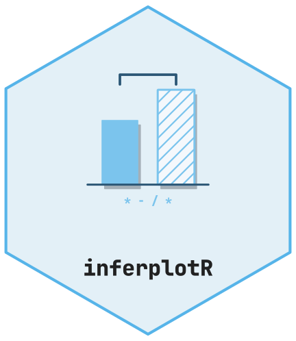

<!-- cttir-vignette-logo: start -->
<style>
.cttir-vignette-logo { float: right; width: 120px; max-width: 30%; margin: 0 0 1rem 1.5rem; }
.cttir-vignette-logo img { width: 100%; height: auto; border: 0; background: transparent; box-shadow: none; }
.cttir-vignette-logo .cttir-vignette-logo-light { display: block; }
.cttir-vignette-logo .cttir-vignette-logo-dark { display: none; }
@media (prefers-color-scheme: dark) {
  .cttir-vignette-logo .cttir-vignette-logo-light { display: none; }
  .cttir-vignette-logo .cttir-vignette-logo-dark { display: block; }
}
[data-bs-theme="light"] .cttir-vignette-logo .cttir-vignette-logo-light { display: block; }
[data-bs-theme="light"] .cttir-vignette-logo .cttir-vignette-logo-dark { display: none; }
[data-bs-theme="dark"] .cttir-vignette-logo .cttir-vignette-logo-light { display: none; }
[data-bs-theme="dark"] .cttir-vignette-logo .cttir-vignette-logo-dark { display: block; }
</style>
<div class="cttir-vignette-logo">
  
  
</div>
<!-- cttir-vignette-logo: end -->

```{r setup, include = FALSE}
knitr::opts_chunk$set(collapse = TRUE, comment = "#>", fig.width = 5, fig.height = 3.5,
  dev = if (requireNamespace("ragg", quietly = TRUE)) "ragg_png" else "png")
```

inferplotR is a ggplot2 extension for black-and-white figures. This vignette
covers the parts that do not compute statistics: the theme for papers and
slides, the scales that replace color, end labels, size presets with export,
light and dark modes, and the APA audit. The inference layers have their own vignette,
`vignette("inference-layers", package = "inferplotR")`. All examples use data
sets that ship with R and run offline.

```{r packages}
library(ggplot2)
library(inferplotR)
```

## One theme, two targets

`theme_figure()` is a complete ggplot2 theme. It draws all text and lines in
black on a white background and uses no gray. Every text element resolves to
between 8 and 14 pt at the default `base_size = 9`, the range the APA Style page
on figures asks for. `target = "paper"` is meant for journal figures: one font
family and 2 mm margins. `target = "slide"` is meant for slides set with the
Bleisatz Beamer theme: 1 mm margins, so the figure sits flush in its slot, and
condensed axis titles when IBM Plex Sans Condensed is installed.

```{r targets, fig.show = "hold", out.width = "48%", fig.width = 3.4, fig.height = 2.8, fig.alt = c("Scatter plot of fuel economy against weight in the paper theme: black points and axes on white, legend inside the panel.", "The same scatter plot in the slide theme with a dotted horizontal grid and the legend below the panel.")}
p <- ggplot(mtcars, aes(wt, mpg, shape = factor(cyl))) +
  geom_point() +
  scale_shape_figure() +
  labs(x = "Weight (1000 lb)", y = "Fuel economy (mpg)", shape = "Cylinders")

p + theme_figure("paper")
p + theme_figure("slide", grid = "y", legend = "bottom")
```

The legend sits inside the panel by default (`legend = "inside"`); `"right"`,
`"bottom"` and `"none"` are the alternatives. `grid` adds dotted major grid
lines, and `border = TRUE` draws a frame around the panel.

Text uses `figure_font()`: IBM Plex Sans (or Plex Mono for `"mono"`) when the
font is installed and reported by systemfonts, otherwise R's generic `"sans"` and
`"mono"` families. Fonts are never bundled or registered. IBM Plex ships with
TeX Live (in `fonts/opentype/ibm/plex`). To make it available to R through
fontconfig, copy the Sans, Sans Condensed and Mono OTF files to `~/.fonts`
and run `fc-cache -f`; then call `figure_font(reset = TRUE)` or start a new
session. On this machine:

```{r font}
figure_font()
```

## Scales without color

Groups are told apart by line type, point shape or hatch pattern. The scales
use fixed sequences and never recycle: more groups than values is an error of
class `inferplotR_too_many_groups` when the plot is built.

- `scale_linetype_figure()`: solid, dashed and dotted patterns, six in total.
- `scale_shape_figure()`: eight shapes, alternating filled and open.
- `scale_colour_ink()` (alias `scale_color_ink()`): maps every group to black,
  for layers that map `colour` but should stay black.
- `scale_fill_hatch()`: solid, open, hatch, dots, crosshatch and backhatch;
  `hatch_pattern()` makes a single fill value.

```{r hatch, fig.alt = "Grouped bar chart of mean tooth length by vitamin C dose; orange juice bars are solid black, ascorbic acid bars are white with a black outline."}
tooth <- aggregate(len ~ supp + dose, data = ToothGrowth, FUN = mean)
tooth$dose <- factor(tooth$dose)

ggplot(tooth, aes(dose, len, fill = supp)) +
  geom_col(colour = "black", width = 0.7, position = position_dodge(width = 0.8)) +
  scale_fill_hatch(name = "Supplement", labels = c("Orange juice", "Ascorbic acid")) +
  theme_figure(legend = "right") +
  labs(x = "Dose (mg/day)", y = "Mean tooth length (mm)")
```

With two groups the bars are solid and open. From the third group on they are
grid patterns, which need a pattern-capable graphics device: `cairo_pdf()`,
`svg()`, `pdf()` or the ragg devices. Give the bars a black outline so that
open bars stay visible.

```{r hatch-four, fig.alt = "Four bars filled solid black, white, diagonal hatching and dots."}
four <- data.frame(diet = paste("Diet", 1:4),
                   weight = tapply(ChickWeight$weight, ChickWeight$Diet, mean))

ggplot(four, aes(diet, weight, fill = diet)) +
  geom_col(colour = "black", width = 0.6) +
  scale_fill_hatch(guide = "none") +
  theme_figure() +
  labs(x = NULL, y = "Mean weight (g)")
```

## End labels instead of a legend

`geom_endlabel()` writes each group's label next to its last point, so lines
can be identified without a legend or color. The labels sit outside the data,
so leave room for them: switch clipping off and widen the right margin, or
expand the x scale.

```{r endlabel, fig.alt = "Four lines of mean chick weight over 21 days, one per diet, in different line types, each labeled at its right end."}
chicks <- aggregate(weight ~ Diet + Time, data = ChickWeight, FUN = mean)
chicks$Diet <- paste("Diet", chicks$Diet)

ggplot(chicks, aes(Time, weight, linetype = Diet, label = Diet)) +
  geom_line(show.legend = FALSE) +
  geom_endlabel() +
  scale_linetype_figure() +
  coord_cartesian(clip = "off") +
  theme_figure(legend = "none") +
  theme(plot.margin = margin(2, 16, 2, 2, unit = "mm")) +
  labs(x = "Days since birth", y = "Mean weight (g)")
```

## Size presets and export

`figure_size()` returns a named size in millimeters. The journal presets are
common single- and double-column widths; APA style prescribes no physical
width, so check the journal's author guidelines. The slide presets match the
slots of the Bleisatz frame, whose text width is 134 mm.

```{r sizes}
presets <- c("journal_column", "journal_page", "slide_full", "slide_side", "slide_half")
do.call(rbind, lapply(presets, function(x)
  data.frame(preset = x, width = figure_size(x)$width, height = figure_size(x)$height)))
```

`save_figure()` writes a plot at a preset or at an explicit size, on a white
background (or none, with `transparent = TRUE`). The file extension selects the device: `cairo_pdf()` for PDF
(fonts embedded, patterns supported), the ggsave PNG and TIFF devices (ragg
when installed) and `svg()` for SVG.

```{r save}
p_paper <- p + theme_figure("paper")
pdf_file <- save_figure(p_paper, file.path(tempdir(), "fuel.pdf"))
png_file <- save_figure(p_paper + theme_figure("slide"),
                        file.path(tempdir(), "fuel-slide.png"),
                        preset = "slide_half", dpi = 300)
file.exists(c(pdf_file, png_file))
```

## Light, dark and transparent

Every function that draws takes `mode = "light"` (black on white, the default)
or `"dark"` (white on black) and `transparent = FALSE` or `TRUE`. A transparent
figure has no background at all: no plot, panel or legend background and no
paper behind hatch tiles or open markers, only the ink. Pass the same values
to the theme and to every layer and scale that takes them:

```{r modes, fig.show = "hold", out.width = "48%", fig.width = 3.4, fig.height = 2.8, fig.alt = c("Mean tooth length by dose as bars with solid and open fills, black on white.", "The same chart in dark mode: white outlines and fills on black, the open bars black.")}
bars <- function(mode = "light", transparent = FALSE) {
  ggplot(tooth, aes(dose, len, fill = supp)) +
    geom_col(colour = if (mode == "dark") "white" else "black", width = 0.7,
             position = position_dodge(width = 0.8)) +
    scale_fill_hatch(name = "Supplement", labels = c("Orange juice", "Ascorbic acid"),
                     mode = mode, transparent = transparent) +
    theme_figure(legend = "bottom", mode = mode, transparent = transparent) +
    labs(x = "Dose (mg/day)", y = "Mean tooth length (mm)")
}
bars("light")
bars("dark")
```

Dark figures are meant for slide decks in a dark theme and for inverse
frames. `save_figure_set()` writes one figure in all four modes, light, dark
and both transparent, each into its own folder under the same file name. It
takes a function of `mode` and `transparent`, like `bars()` above:

```{r save-set}
set <- save_figure_set(bars, "tooth-bars", preset = "slide_half",
                       dir = file.path(tempdir(), "figures"), png = FALSE)
set[, c("mode", "format", "width_mm", "height_mm")]
basename(set$file)
```

A Bleisatz deck includes the figure as `\includegraphics{tooth-bars}` and
chooses the folder once, with `\graphicspath{{figures/dark/}}` for a deck in
`\usetheme[dark]{Bleisatz}`. The figure gallery vignette,
`vignette("figure-gallery", package = "inferplotR")`, shows the twelve example
figures of the Bleisatz theme that `figure_gallery()` writes this way.

## Audit a figure with `check_figure()`

`check_figure()` builds a plot once and reports, in six rows, where it departs
from the APA figure rules or from inferplotR's black-and-white rule. A default
ggplot fails several of them:

```{r check-bad}
bad <- ggplot(mtcars, aes(wt, mpg, colour = factor(cyl))) +
  geom_point() +
  labs(title = "fuel economy")
report <- check_figure(bad)
report[, c("check", "source", "status")]
cat(paste0(report$check, ": ", report$detail)[report$status != "pass"], sep = "\n")
```

The gray panel and the hue palette fail `two_values`; the axis labels `wt` and
`mpg` give no unit; the title belongs above the figure in the manuscript, not in
the image; and the legend title starts in lower case. The fixed figure uses
shapes instead of colors, the figure theme and labels with units, and moves
the title out of the image:

```{r check-good}
good <- ggplot(mtcars, aes(wt, mpg, shape = factor(cyl))) +
  geom_point() +
  scale_shape_figure() +
  theme_figure() +
  labs(x = "Weight (1000 lb)", y = "Fuel economy (mpg)", shape = "Cylinders")
check_figure(good)[, c("check", "status")]
```

The audit reads the plot specification. It cannot see the figure number,
the title or the note in the manuscript, and it checks only the first letter of
legend text for title case.

## Sources

The text-size, font, legend, axis-label and title rules follow the APA Style
page on figures (American Psychological Association, *Figures*, 7th ed.,
<https://apastyle.apa.org/style-grammar-guidelines/tables-figures/figures>).
The theme and layers are built on ggplot2 (Wickham 2016,
<https://doi.org/10.1007/978-3-319-24277-4>); hatch patterns use the grid
patterns of R 4.1.0 and later. See the README for the full list of sources.
