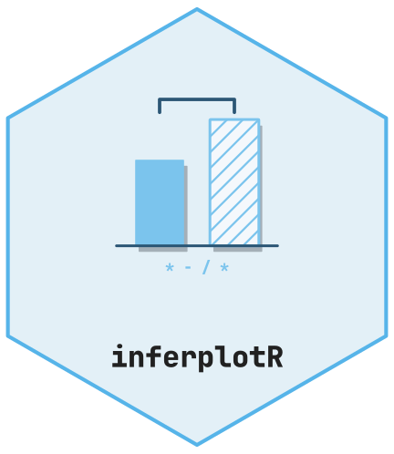
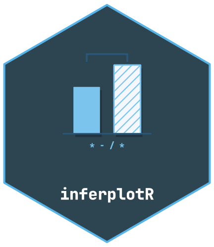

<!-- cttir-vignette-logo: start -->
<style>
.cttir-vignette-logo { float: right; width: 120px; max-width: 30%; margin: 0 0 1rem 1.5rem; }
.cttir-vignette-logo img { width: 100%; height: auto; border: 0; background: transparent; box-shadow: none; }
.cttir-vignette-logo .cttir-vignette-logo-light { display: block; }
.cttir-vignette-logo .cttir-vignette-logo-dark { display: none; }
@media (prefers-color-scheme: dark) {
  .cttir-vignette-logo .cttir-vignette-logo-light { display: none; }
  .cttir-vignette-logo .cttir-vignette-logo-dark { display: block; }
}
[data-bs-theme="light"] .cttir-vignette-logo .cttir-vignette-logo-light { display: block; }
[data-bs-theme="light"] .cttir-vignette-logo .cttir-vignette-logo-dark { display: none; }
[data-bs-theme="dark"] .cttir-vignette-logo .cttir-vignette-logo-light { display: none; }
[data-bs-theme="dark"] .cttir-vignette-logo .cttir-vignette-logo-dark { display: block; }
</style>
<div class="cttir-vignette-logo">
  
  
</div>
<!-- cttir-vignette-logo: end -->

```{r setup, include = FALSE}
knitr::opts_chunk$set(collapse = TRUE, comment = "#>")
has_cairo <- isTRUE(capabilities("cairo"))
```

The figure layer draws every figure for a slot: 134, 86 or 64 mm wide and
44 mm high on a slide, or 52 x 40 mm in the margin of a handout. This
vignette turns figures into a complete **Bleisatz** slide deck and into a
paper from the same figures. Bleisatz is a strictly black-and-white Beamer
theme with a matching document class; both are bundled with the package
(version 1.3), so the `.tex` files written here compile without anything
else from the theme. Nothing in this vignette runs LaTeX: writing a deck or a
document never needs it, and compiling is a separate, optional step.

## From figure to deck

A figure for a deck is best written as a function of the mode, so that a dark
deck and inverse frames get a white-on-black version of it. The function
takes `mode` and `transparent` (and optionally `palette`) and passes them on
to the theme and layers, as for `save_figure_set()`:

```{r build}
library(infereportR)
library(ggplot2)

growth <- function(mode, transparent) {
  d <- aggregate(weight ~ Time + Diet, data = ChickWeight, FUN = mean)
  ggplot(d, aes(Time, weight, linetype = Diet, label = paste("Diet", Diet))) +
    geom_line(colour = if (mode == "dark") "white" else "black") +
    geom_endlabel(mode = mode, transparent = transparent) +
    scale_linetype_figure() +
    theme_figure("slide", legend = "none", mode = mode, transparent = transparent) +
    theme(plot.margin = margin(1, 14, 1, 1, "mm")) +
    labs(x = "Days since birth", y = "Mean weight (g)")
}
```

Each slide is made by one constructor; `figure_deck()` collects them with
the title page:

```{r deck}
deck <- figure_deck(
  list(
    section_slide("Growth"),
    figure_slide(growth, "Chicks on diet 3 grow fastest",
                 caption = "Mean weight by diet; lines are labeled at their ends.",
                 text = c(Rule = "Label lines directly."),
                 source = "R datasets: ChickWeight."),
    figure_slide(growth, "The diets part after the first week", layout = "half",
                 caption = "The same figure in the half slot.",
                 text = "The second column holds the caption and the argument."),
    keyfigure_slide("Chicks on diet 3 weigh most on day 21", "270 g",
                    "mean weight on day 21, diet 3", "n = 10 chicks"),
    figure_slide(title = "Every figure exists in light and dark", layout = "side",
                 name = "02-chicks-on-diet-3-grow-fastest", inverse = TRUE,
                 caption = "The first figure again, on an inverse frame.")
  ),
  title = "Diet and growth in chicks", author = "A. Author", institute = "Institute",
  venue = c("Meeting", "City"), progress = "dots"
)
deck
```

`save_deck()` writes everything into a directory, which has no default:
each figure at the size of its slot in the mode folders the theme finds, the
theme file, and the `.tex` file.

```{r save-deck, eval = has_cairo}
dir <- file.path(tempdir(), "chick-deck")
files <- save_deck(deck, dir)
table(files$type)
sort(list.files(dir, recursive = TRUE))
```

The `.tex` file is an ordinary Bleisatz deck, using only the commands of the
theme, so it is the start of the talk rather than its end:

```{r show-deck, eval = has_cairo}
cat(readLines(file.path(dir, "deck.tex"))[15:40], sep = "\n")
```

## Slots, modes and inverse frames

| `layout` | Slot | LaTeX |
|---|---|---|
| `"side"` | 86 x 44 mm | `\sidefigure[0.64]{...}{caption}`, the numbered caption beside the figure |
| `"half"` | 64 x 44 mm | two columns, 0.48 and 0.46 of the text width: figure, then caption and text |
| `"full"` | 134 x 44 mm | `\includegraphics[width=\textwidth]`, the numbered caption on the source line |
| `"text"` | none | one string: a paragraph; several: a list; named strings: small labels |

A figure is saved in every folder of `figure_modes` (by default light, dark
and the two transparent modes) under the same file name, so switching the
deck to `mode = "dark"` changes one theme option and nothing else. An
inverse slide (`inverse = TRUE`) is set as the theme's inverse frame and
points `\graphicspath` at the opposite mode folder. A plain ggplot instead
of a function is saved unchanged in every mode, which is right for light
decks only.

## Theme options and Tufte's aspects

Every option of the theme is an argument of `figure_deck()`, and only the
options given are written: `palette` (`"onebit"`, `"grey"`, `"tufte"`),
`font` (`"plex"`, `"mono"`, `"c64"`, `"etbb"`), `rules`, `typography`,
`emphasis`, `figures`, `progress` (`"bar"` by default, `"dots"`, `"none"`),
`head`, `sectionpages` and `total`. `tufte = TRUE` sets each aspect to
Tufte's value at once (palette with grey, red and green, ET Book, hairlines,
italic emphasis, the Tufte figure set, no running head, no progress
indicator, no section pages), and any option given beside it wins:

```{r tufte-deck}
tufte_deck <- figure_deck(
  list(figure_slide(growth, "Chicks on diet 3 grow fastest", name = "growth")),
  title = "Diet and growth", tufte = TRUE, palette = "grey", head = TRUE)
tufte_deck
```

The figures follow the deck: they are drawn in its palette, and with the
Tufte figure set they go into `figures/tufte/<mode><suffix>/`, the folders
the theme's `\figurefolder{figures}` searches first (`light-grey` here).

## A paper from the same figures

`figure_document()` sets blocks with the document class `bleisatz.cls`. Its
text block is 134 mm wide, so the slide figures go in at 100 %: `"side"` puts
the caption beside an 86 mm figure, `"full"` below a 134 mm one, `"half"`
beside a 64 mm one, and `"margin"` puts a 52 x 40 mm figure in the margin of
the Tufte layout.

```{r document}
fit <- infercalcR::run_inference(
  infercalcR::method_spec("t_means_two_independent_welch"),
  x = ChickWeight$weight[ChickWeight$Diet == 3 & ChickWeight$Time == 21],
  y = ChickWeight$weight[ChickWeight$Diet == 1 & ChickWeight$Time == 21])
tab <- report_table(fit)[, c("estimate_display", "interval_display", "p_display")]
names(tab) <- c("Difference (g)", "95% CI", "p")

doc <- figure_document(
  list(
    document_section("Results", paste("Chicks on diet 3 weighed more on day 21",
                                      "than chicks on diet 1 (Table \\ref{tab:diet}).")),
    document_note("R datasets: ChickWeight."),
    document_figure(growth, caption = "Mean weight by diet.", label = "fig:growth",
                    source = "R datasets: ChickWeight.",
                    name = "02-chicks-on-diet-3-grow-fastest"),
    document_table(tab, caption = "Diet 3 minus diet 1, day 21", label = "tab:diet",
                   note = "Welch t-test from infercalcR.")
  ),
  title = "Diet and growth in chicks", shorttitle = "Diet and growth",
  author = c("A. Author", "Institute"), keywords = "growth, diet, simulated report",
  abstract = "One paragraph: question, design, main result with its uncertainty.")
doc
```

Giving the figure the file name it has in the deck writes the same files, so
the talk and the paper share one figure set. `save_document()` writes the
document like a deck:

```{r save-document, eval = has_cairo}
dir_doc <- file.path(tempdir(), "chick-paper")
save_document(doc, dir_doc, png = FALSE)
cat(readLines(file.path(dir_doc, "document.tex"))[13:40], sep = "\n")
```

For a handout in Tufte's layout, use `tufte = TRUE` or single aspects
(`layout = "tufte"`, `notes = "side"`), with `document_note()` for
sidenotes (`numbered = FALSE` for an unnumbered margin note),
`document_newthought()`, `document_fullwidth()`, `document_epigraph()` and
`document_sparkline()`. A `.bib` file given as `bibliography` is copied next
to the `.tex` file and loaded with biblatex (APA style, biber); cite with
`\parencite{key}` in any text.

## Text, colors and sparklines

All text is escaped for LaTeX, so `50% & more` arrives as written. The
palette commands of the theme come from `tex_red()`, `tex_green()` and
`tex_muted()`, and word-sized sparklines from `sparkline_tex()`. Their LaTeX
passes through the escaping of slide and block text unchanged, as do citation
commands and `\ref{}`, while the rest of the sentence is escaped:

```{r text}
c5a <- c(9.0, 16.9, 20.4, 20.7, 20.1, 17.7, 11.7, 9.4)
s <- paste("C5a rose to", tex_green("20.7"), tex_muted("ng/ml"),
           sparkline_tex(c5a, at = c(0, 2, 4, 6, 8, 12, 24, 48), marks = "both"),
           "and fell back to", tex_red("9.4"), "(50% & more).")
cat(s)
```

`slide_sparkline()` and `document_sparkline()` set a table of sparklines
with the peak in green and the last value in red; without colors in the
palette the theme sets them in ink and italic.

## Compiling

`render_deck()` and `render_document()` compile in the directory and return
the PDF. They use latexmk (pdfLaTeX, or LuaLaTeX for `font = "c64"`), else
the engine itself, else TinyTeX through the 'tinytex' package. Without any
of them they raise a condition of class `infereportR_missing_dependency`;
the `.tex` file then compiles anywhere else, for example on Overleaf.

```{r render, eval = FALSE}
render_deck(dir)
render_document(dir_doc)
```

## The gallery decks

`figure_gallery_deck()` writes the twelve example figures of the gallery as
the deck of the theme's `gallery.tex`, and with `set = "tufte"` the Tufte set
as a deck and a handout in the structure of the theme's Tufte samples:

```{r gallery, eval = FALSE}
figure_gallery_deck(file.path(tempdir(), "gallery"), render = TRUE)
figure_gallery_deck(file.path(tempdir(), "tufte"), set = "tufte", mode = "dark",
                    palette = "grey")
```

## R Markdown and Quarto

Two R Markdown templates come with the package: "infereportR slides
(Bleisatz)", a `beamer_presentation`, and "infereportR document (Bleisatz)",
a `pdf_document` with `documentclass: bleisatz`. Create them from the
RStudio menu (File, New File, R Markdown, From Template) or with

```{r rmarkdown, eval = FALSE}
rmarkdown::draft("talk.Rmd", template = "bleisatz", package = "infereportR")
rmarkdown::draft("paper.Rmd", template = "bleisatz-document", package = "infereportR")
```

Both list every theme or class option in the YAML header, commented out,
copy the theme or class next to the document in their setup chunk, size the
figure chunks with `figure_size()` and place them with the theme's own
commands. They use a short pandoc template of their own: pandoc's default
LaTeX templates load Latin Modern, microtype, page geometry and section
settings after the class, which would override the Bleisatz type and layout.

For Quarto, `use_deck_quarto(dir)` and `use_document_quarto(dir)` copy the
extension `bleisatz` (formats `bleisatz-beamer` and `bleisatz-pdf`) with a
starting `deck.qmd` or `document.qmd`.

## License of the bundled files

The theme `beamerthemeBleisatz.sty` and the class `bleisatz.cls` are bundled
unmodified and are distributed under the LaTeX Project Public License 1.3c;
the rest of the package, including every file written by `save_deck()` and
`save_document()` apart from those two, is MIT licensed.

```{r cleanup, include = FALSE}
unlink(c(file.path(tempdir(), "chick-deck"), file.path(tempdir(), "chick-paper")),
       recursive = TRUE)
```

```{r acknowledgments, child = "children/_acknowledgments.Rmd"}
```
