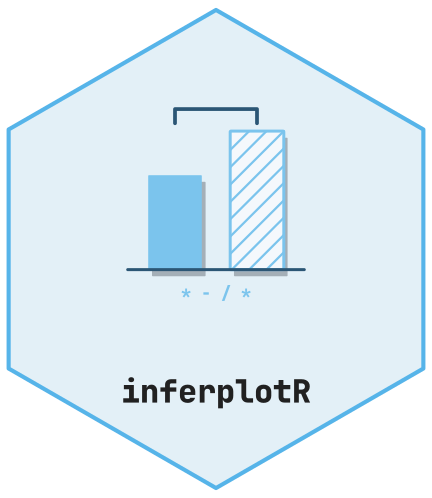
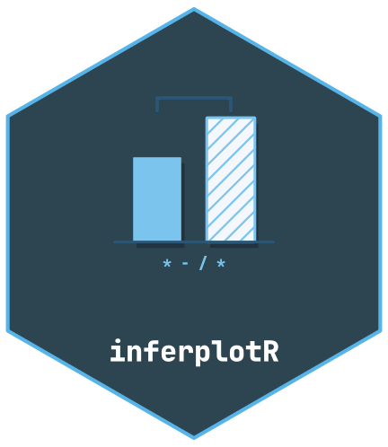

<!-- cttir-vignette-logo: start -->
<style>
.cttir-vignette-logo { float: right; width: 120px; max-width: 30%; margin: 0 0 1rem 1.5rem; }
.cttir-vignette-logo img { width: 100%; height: auto; border: 0; background: transparent; box-shadow: none; }
.cttir-vignette-logo .cttir-vignette-logo-light { display: block; }
.cttir-vignette-logo .cttir-vignette-logo-dark { display: none; }
@media (prefers-color-scheme: dark) {
  .cttir-vignette-logo .cttir-vignette-logo-light { display: none; }
  .cttir-vignette-logo .cttir-vignette-logo-dark { display: block; }
}
[data-bs-theme="light"] .cttir-vignette-logo .cttir-vignette-logo-light { display: block; }
[data-bs-theme="light"] .cttir-vignette-logo .cttir-vignette-logo-dark { display: none; }
[data-bs-theme="dark"] .cttir-vignette-logo .cttir-vignette-logo-light { display: none; }
[data-bs-theme="dark"] .cttir-vignette-logo .cttir-vignette-logo-dark { display: block; }
</style>
<div class="cttir-vignette-logo">
  
  
</div>
<!-- cttir-vignette-logo: end -->

```{r setup, include = FALSE}
knitr::opts_chunk$set(collapse = TRUE, comment = "#>", dpi = 96,
  dev = if (requireNamespace("ragg", quietly = TRUE)) "ragg_png" else "png")
mm <- function(x) x / 25.4
```

Version 1.3 of the Bleisatz theme makes every aspect of Edward Tufte's design
an option of its own, and the figure layer of infereportR follows it. Each
option is opt-in: without it a figure is the same strict black-and-white
Bleisatz figure as before. This vignette takes the options one by one, each
with a small figure, and ends with the Tufte set of the Bleisatz gallery.

```{r packages}
library(ggplot2)
library(infereportR)
```

## Palette

`palette` is an argument of `theme_figure()`, of every layer and builder, of
`report_figure()`, `save_figure_set()` and `check_figure()`. It is resolved
together with `mode` by one internal resolver, so a figure never names a color.

| `palette` | Colors | Use |
|---|---|---|
| `"onebit"` (default) | ink, paper | unchanged behavior |
| `"grey"` | ink, paper, one grey `#999999` | context, units, sources, context lines |
| `"tufte"` | as `"grey"`, plus red and green | red: the first or last value and the one series to watch; green: highs and lows |

Red and green are `#B3202A` and `#2E7D32` on white, `#E5484D` and `#5DB760`
on black. Tufte used blue for the extremes; Bleisatz keeps to one pair of
colors. In `"onebit"` the grey is ink drawn as a hairline and red and green
fall back to ink, so a figure written for `"tufte"` still reads in two values.
`scale_colour_palette()` maps levels to these roles, and `check_figure()`
checks the colors against the palette the figure was drawn in (the row keeps
its name `two_values`).

```{r palette, fig.width = mm(64), fig.height = mm(44)}
d <- data.frame(x = rep(1:6, 3), y = c(1:6, 6:1, c(2, 3, 3, 4, 3, 2)),
                g = rep(c("context", "watch", "range"), each = 6))
p <- ggplot(d, aes(x, y, colour = g)) +
  geom_line(linewidth = 0.6) +
  scale_colour_palette(c("grey", "green", "red"), palette = "tufte", guide = "none") +
  labs(x = "Week", y = "Score (points)") +
  theme_figure("slide", palette = "tufte")
p
check_figure(p, "slide", palette = "tufte")$status[3]
check_figure(p, "slide")$status[3]
```

## Range frame and dot-dash axes

A range frame is an axis that runs only from the smallest to the largest
value. `geom_rangeframe()` draws it from the layer data, per panel and after
scale transformations; `theme_figure(axes = "range")` removes the full axis
lines and keeps the ticks, and breaks at the extremes complete it.

`geom_dotdash()` goes one step further and draws each axis as one dash per
observation, a rug outside the panel where the axis would be, so the axes
carry both margins. The dashes lie outside the panel: switch clipping off,
drop the ticks and move the axis text a little away. The figure below has
both: the frame on the left, the dashes on the bottom.

```{r rangeframe, fig.width = mm(64), fig.height = mm(44)}
ggplot(mtcars, aes(wt, mpg)) +
  geom_point(size = 0.8) +
  geom_rangeframe(sides = "l") +
  geom_dotdash(sides = "b") +
  coord_cartesian(clip = "off") +
  scale_x_continuous(breaks = range(mtcars$wt)) +
  scale_y_continuous(breaks = c(min(mtcars$mpg), 20, 30, max(mtcars$mpg))) +
  labs(x = "Weight (1000 lb)", y = "Fuel economy (mpg)") +
  theme_figure("slide", axes = "range") +
  theme(axis.ticks.x = element_blank(),
        axis.text.x = element_text(margin = margin(t = 2.2, unit = "mm")))
```

## Quartile plot

`stat_quartiles()` is the box plot without the box: a line from the minimum to
the lower quartile, another from the upper quartile to the maximum, and a dot
at the median. The gap is the interquartile range. The five numbers are
geometry (`stats::quantile()`, type 7) and no number is printed; quartiles
reported as text come from finalized results through the reporting functions.

```{r quartiles, fig.width = mm(64), fig.height = mm(44)}
ggplot(PlantGrowth, aes(group, weight)) +
  geom_rangeframe(sides = "l") +
  geom_point(aes(x = as.numeric(group) + 0.2), colour = "#999999", size = 0.6) +
  stat_quartiles() +
  labs(x = NULL, y = "Dried weight (g)") +
  theme_figure("slide", axes = "range", palette = "grey") +
  theme(axis.ticks.x = element_blank())
```

## Paper grid

Bars need no frame, no axis line and no ticks: grid lines in the color of the
paper run through the bars, where a scale is needed. `theme_figure(grid =
"paper")` draws them from the theme, on top of every layer.
`geom_papergrid()` draws the same lines as a layer, so text added after it
stays on top; pair it with `theme_figure(axes = "none")`.

```{r papergrid, fig.width = mm(64), fig.height = mm(44)}
counts <- data.frame(diet = c("1", "2", "3", "4"), pct = c(12, 21, 30, 26))
ggplot(counts, aes(diet, pct)) +
  geom_col(width = 0.6) +
  scale_y_continuous(breaks = c(10, 20, 30), labels = c("10%", "20%", "30%"),
                     expand = c(0, 0)) +
  labs(x = "Diet", y = NULL) +
  theme_figure("slide", grid = "paper")
```

## Slopegraph

`figure_slopegraph()` is Tufte's table-graphic: names and values stand on both
sides at the height of their values, spaced so that close values never
overlap, and the slope is the change. The values are written by the
package's formatting functions.

```{r slopegraph, fig.width = mm(86), fig.height = mm(44)}
cw <- ChickWeight[ChickWeight$Time %in% c(0, 21), ]
s <- aggregate(weight ~ Diet + Time, data = cw, FUN = mean)
slopes <- data.frame(diet = paste("Diet", levels(cw$Diet)),
                     start = s$weight[s$Time == 0], end = s$weight[s$Time == 21])
figure_slopegraph(slopes, "diet", "start", "end", highlight = "Diet 3",
                  titles = c("Day 0", "Day 21"), note = "mean weight, g",
                  palette = "tufte")
```

## Sparklines

`figure_sparklines()` sets word-sized series as a table with the numbers
beside them. Rows of one group share a scale; a band such as the
interquartile range lies behind the line (dotted rules in `"onebit"`). With
`palette = "tufte"` the last value is red and the extremes green, in the line
and in the numbers.

```{r sparklines, fig.width = mm(86), fig.height = mm(44)}
q <- aggregate(weight ~ Diet + Time, data = ChickWeight,
               FUN = function(v) stats::quantile(v, c(0.25, 0.5, 0.75)))
q <- data.frame(diet = paste("Diet", q$Diet), day = q$Time,
                lo = q$weight[, 1], md = q$weight[, 2], hi = q$weight[, 3])
figure_sparklines(q, "day", "md", "diet", lower = "lo", upper = "hi",
                  marks = "both", extremes = "max", x_unit = " d",
                  titles = c(series = "Median weight, day 0-21", max = "Peak",
                             last = "Day 21"),
                  palette = "tufte")
```

For decks and documents, `sparkline_tex()` writes the theme's own
`\sparkline` command, which LaTeX draws in the line of text:

```{r sparkline-tex}
sparkline_tex(q$md[q$diet == "Diet 1"], at = unique(q$day), width = "5em",
              marks = "both", digits = 0)
```

## Context in grey

`stat_context()` draws every unit as a thin line for context and a summary, the
median by default, in ink on top, separated by a casing in the paper color.
Map `group` to the unit and `series` (with `linetype`) to the strata; the
series named in `highlight` is red with `palette = "tufte"`. In `"onebit"`
the context lines are ink hairlines.

```{r context, fig.width = mm(86), fig.height = mm(44)}
cw2 <- ChickWeight[ChickWeight$Diet %in% c("1", "3"), ]
ggplot(cw2, aes(Time, weight, group = Chick, series = Diet, linetype = Diet)) +
  stat_context(highlight = "3", palette = "tufte") +
  geom_rangeframe() +
  scale_linetype_manual(values = c("solid", "42"), guide = "none") +
  labs(x = "Days since birth", y = "Weight (g)") +
  theme_figure("slide", axes = "range", palette = "tufte")
```

## Margin slot and ET Book

`figure_size("margin")` is the 52 x 40 mm slot of the margin of a Tufte
handout (`layout=tufte` in `bleisatz.cls`). `figure_font("etbb")` returns ET
Book (`"ETbb"` or `"ET Book"`) when it is installed, else `"serif"`; ETbb ships
with TeX Live. A serif face fails the APA sans-serif check, so keep it for
Tufte handouts.

## The Tufte set

`figure_gallery(dir, set = "tufte")` writes figures 13-19 of the Bleisatz
gallery, nine files with the two margin variants, in the six folders that
Bleisatz looks up with `\figurefolder{figures}`: `light` and `dark` in
Tufte's palette, `light-grey` and `dark-grey` with the grey only, and
`light-1bit` and `dark-1bit` in two values.

```{r tufte-gallery, eval = FALSE}
figure_gallery(file.path("figures", "tufte"), set = "tufte", png = TRUE)
```

The images below are the light folder, rendered by the package with
`figure_gallery(set = "tufte", modes = "light", png = TRUE, dpi = 96)` and
shipped with the vignette, so that building it does not draw them again
(`tools/gallery/render-tufte-png.R` in the package sources). The captions are
those of `gallery_captions("tufte")`.

```{r tufte-images, echo = FALSE, results = "asis"}
cap <- gallery_captions("tufte")
for (i in seq_len(nrow(cap))) {
  cat(sprintf("{width=%dmm}\n\n%s\n\n",
              cap$name[i], cap$name[i], as.integer(cap$width_mm[i]), cap$caption[i]))
}
```
